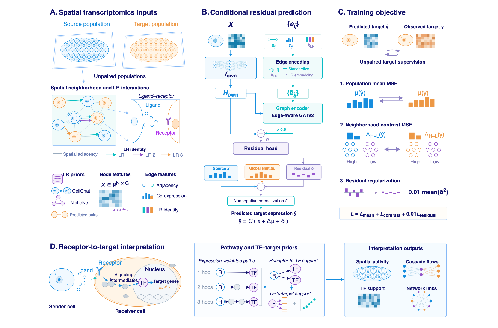

<p align="center">
  
</p>
<h1 align="center">Spike</h1>
<p align="center"><b>Spatially informed and biologically interpretable analysis of cellular reprogramming</b></p>
<p align="center">
  <a href="#installation--setup">Installation</a> ·
  <a href="#the-paper">Paper</a> ·
  <a href="#reproduce-the-paper-figures">Figure notebooks</a>
</p>

## The paper

**Spike enables spatially informed and biologically interpretable analysis of cellular reprogramming**  
Yingying Yu, Zhiwen Wang, Wan Nie, Shiying Li and Shuaicheng Li  
Department of Computer Science, City University of Hong Kong

Spike connects prediction of source-to-target expression changes with interpretation of spatial communication and downstream regulatory programs. It models unpaired spatial transcriptomes using a conditional residual predictor: source expression is combined with a training-population mean shift and a learned residual. A graph branch incorporates spatial neighborhoods and ligand–receptor information. The model does not require cell-to-cell pairing or pseudotime.

The manuscript evaluates expression prediction across seven spatial transcriptomics datasets and examines ligand–receptor associations, receptor–transcription factor support and candidate receptor–TF–target cascades. These analyses prioritize biological hypotheses; inferred links are not direct measurements of causal signaling.

<p align="center">
  
</p>

The overview above is a schematic. Quantitative Figures 2–5 are regenerated from numerical data by the notebooks below.

## Installation & Setup

### Figure reproduction (CPU only)

Clone this repository and create a Python 3.12 environment:

```bash
git clone https://github.com/deepomicslab/spike.git
cd spike
python3.12 -m venv .venv
source .venv/bin/activate
python -m pip install -r requirements-figures.txt
python -m ipykernel install --user --name spike-figures --display-name "Spike figures"
```

On Windows, activate the environment with `.venv\Scripts\activate` instead. Alternatively, use `conda create -n spike-figures python=3.12` and `conda activate spike-figures` before the pip command.

The checked CSV files are included under [`reproduction/tables/`](reproduction/tables/). Figure reproduction needs no external `data/` directory, H5AD files, trained weights, PyTorch or GPU.

### Model source and comparator tools

The published model implementation is [`ConditionalResidual`](perturb/models/conditional_residual.py). Its interface and frozen selection records are documented in [`docs/current_spike_model.md`](docs/current_spike_model.md).

To use that implementation in a separate model environment, install [PyTorch](https://pytorch.org/get-started/locally/) for your CPU/CUDA platform and [PyTorch Geometric](https://pytorch-geometric.readthedocs.io/en/latest/install/installation.html), then install this repository's data dependencies:

```bash
python -m pip install -r requirements.txt
python -c "from perturb.models.conditional_residual import ConditionalResidual; print(ConditionalResidual.__name__)"
```

Run these commands from the repository root. The model is a source module, not a packaged training pipeline. Using it for prediction additionally requires compatible fitted parameters, gene order, preprocessing and graph inputs. The objective is population gene-mean MSE + neighborhood-contrast MSE + residual regularization. The historical [`environment.full.yml`](environment.full.yml) records the Linux comparison environment; [`scripts/train.py`](scripts/train.py) and [`scripts/evaluate.py`](scripts/evaluate.py) serve comparator methods.

## Data and reproducibility

### Dataset names

**RHY 1–4** denote the four mouse brain Visium datasets comparing saline controls with rhynchophylline (RHY) treatment. Each dataset contains a control section and a treated section; spots are not paired between sections.

| Manuscript display name | Stable data/code identifier |
| --- | --- |
| RHY 1 | `brain_sleep1` |
| RHY 2 | `brain_sleep2` |
| RHY 3 | `brain_sleep3` |
| RHY 4 | `brain_sleep4` |

WT, SHH and PSAPP retain their existing names. Documentation, plot labels and notebook table previews use the manuscript display names. Original CSV identifiers, data paths and frozen provenance records are unchanged for reproducibility. The display mapping is defined in [`reproduction/common.py`](reproduction/common.py).

### Reproduction snapshot

Each figure notebook validates the supplied table hashes, draws every panel from CSV values, and writes fresh PNG/PDF/SVG files under `outputs/reproduction/figureN/`. The full figure is assembled from those newly drawn panels in memory. The notebooks never use `notebooks/manuscript/*.png` as plotting inputs.

The numerical figure snapshot follows the manuscript available on **13 October 2026**; dataset display names were aligned with the manuscript on **14 October 2026**, without changing the numerical inputs. Its benchmark and gene-count panels use the released seven-dataset graph predictions and matched split-42 State results (training seeds 41/42/43). This is recorded separately from the original validation-selected graph/expression-only model configuration. Reproduction does not train models or change that frozen configuration. Figure 5A–D retain the historical architecture ablation; Figure 5E uses the manuscript conditional-residual results.

[`reproduction/manifest.json`](reproduction/manifest.json) records numerical input hashes and manuscript identity. [`reproduction/README.md`](reproduction/README.md) documents panel sources, plotting semantics and verification. Training seeds quantify optimization variability, not biological replication. Figure reproduction starts from released results; it does not repeat model training.

## Reproduce the paper figures

Open the [notebook collection](notebooks/README.md), select the **Spike figures** kernel, and use **Restart Kernel and Run All Cells**:

```bash
jupyter lab notebooks/
```

| Notebook | Manuscript figure | Contents |
| --- | --- | --- |
| [Figure 2](notebooks/figure2.ipynb) | Figure 2, A–E | Expression benchmark, spatial maps, distributions and TF support |
| [Figure 3](notebooks/figure3.ipynb) | Figure 3, A–F | LR enrichment, expression changes, NCAM1 maps and catalogue comparisons |
| [Figure 4](notebooks/figure4.ipynb) | Figure 4, A–G | Spatial response, enrichment, receptor–TF networks and cascades |
| [Figure 5](notebooks/figure5.ipynb) | Figure 5, A–E | Historical architecture ablation and gene-count robustness |

Run the entire collection without opening Jupyter:

```bash
python scripts/execute_figure_notebooks.py
```

Executed notebooks, including inline figure previews, are saved directly in `notebooks/` and copied to `outputs/executed_notebooks/`. Regenerated figures and validation records are saved under `outputs/reproduction/`. See the [notebook collection and panel guide](notebooks/README.md) for individual figure commands and output details.
